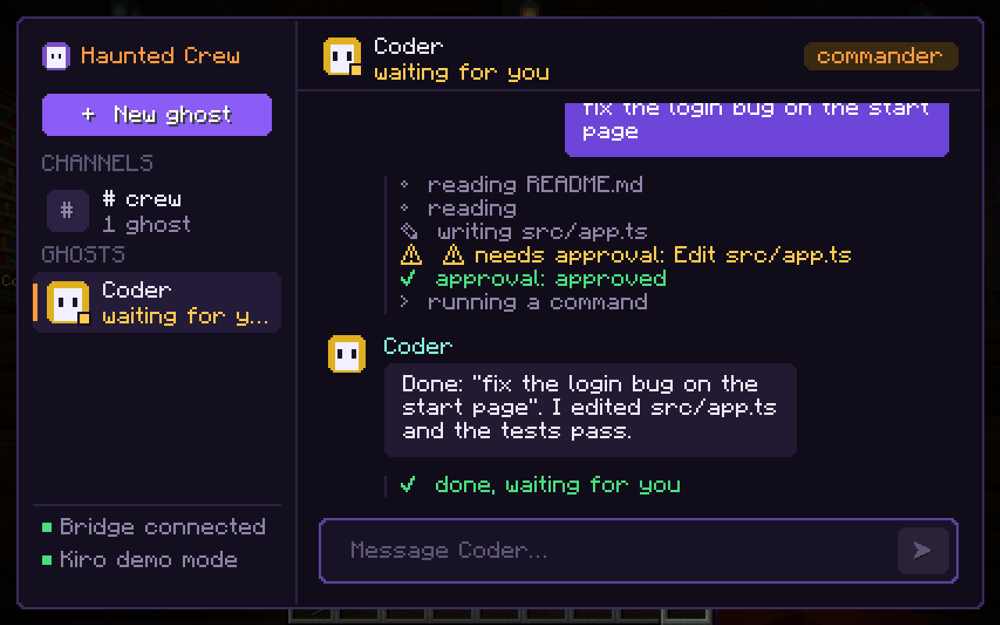
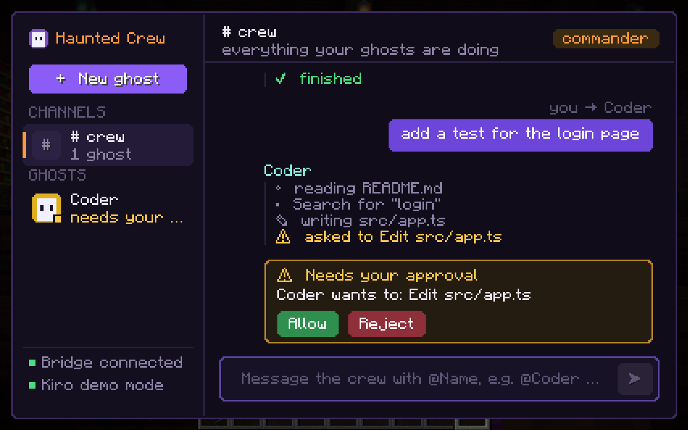
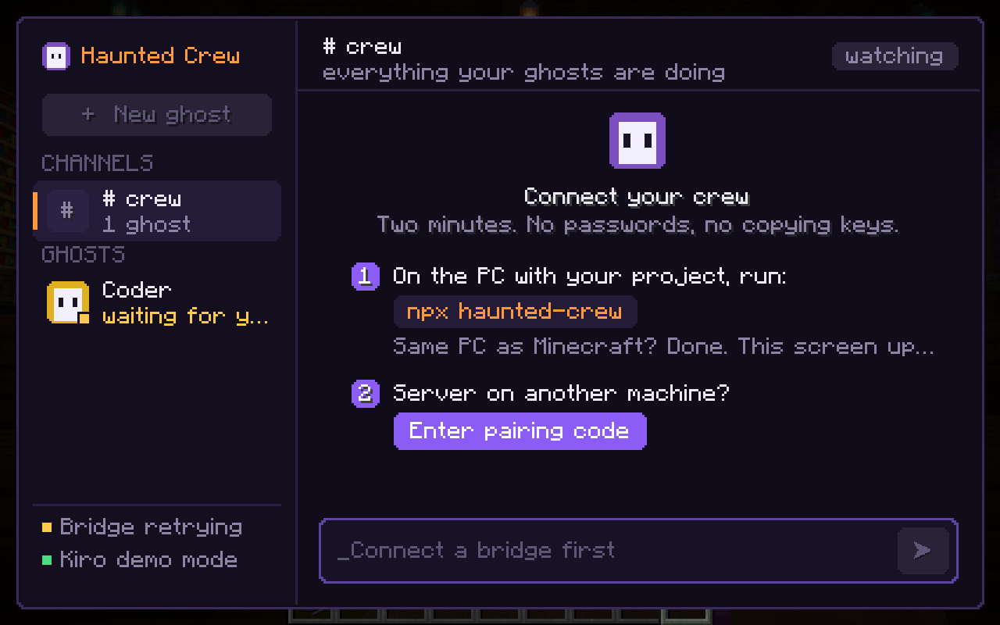

# 👻 Haunted Crew

Your Kiro agents, haunting Minecraft. Every agent is a ghost at a desk in a haunted office: you
watch them read, write and run things, they float over when they need you, and you talk to them
in an AI-chat console without leaving the game. Friends can join the server and watch your crew work.



## Install with Kiro (easiest)

Let your agent do it. Either:

- **Kiro Power:** Kiro → Powers panel → **Add Custom Power** → **Import power from GitHub** → paste
  this repository's URL. Then ask Kiro: *"set up Haunted Crew"*.
- **Any agent:** copy the prompt in [INSTALL_PROMPT.md](INSTALL_PROMPT.md) into Kiro (or any agent that can
  run terminal commands). It installs the mod, Fabric and the bridge step by step and tells you what to click.

## Quick start (about 2 minutes)

You need: Minecraft Java **26.3** with **Fabric Loader** and **Fabric API**, Node.js 20+, and the
[Kiro CLI](https://kiro.dev/downloads) (or nothing, in demo mode).

1. **Install the mod.** `npx -p haunted-crew haunted-crew-minecraft` installs Fabric Loader, Fabric API and
   the mod into Minecraft 26.3 (or put `hauntedcrew-<version>.jar` in your `mods` folder yourself).
2. **Start the crew** in the folder of the project your agents should work on:
   ```bash
   npx haunted-crew            # once published to npm
   node bridge/bin/haunted-crew.mjs   # from this repo, today
   ```
   It installs the Kiro hooks into the project, checks your Kiro sign-in, starts the bridge and
   prints a pairing code. Add `--demo` to try everything with a pretend agent and no Kiro account.
3. **Open Minecraft** → Singleplayer → Create New World → World Type **Haunted Office**.
4. **Press K.** On the same PC the console connects by itself. Sign in to Kiro from the console if
   it asks (Kiro's own sign-in page, we never see your password), pick a job, and give your ghost a task.

The key is rebindable: Options → Controls → Key Binds → **Haunted Crew → Open agent console**.

**Live dashboard:** the launcher prints a read-only link (`http://127.0.0.1:8787/#token=…`). The same
dashboard runs on the big screen in the Haunted Office: crew status on the left, live activity on the right.

**Faster, cheaper ghosts:** ghosts default to `claude-haiku-5.5` (0.06x credits). Pick another model per
ghost in the console, or for all with `--model claude-sonnet-5.5`. Ghosts skip your MCP servers so they
start in about a second; add `--mcp` to give them your MCP servers. Up to 70 ghosts can work at once.

## Workflows

Chain ghosts into a team, n8n-style, right inside Minecraft: press **K** → **Workflows**. Drag boxes,
drag from a box's right dot to another box to connect them, mouse wheel zooms, Delete removes. The same
editor also runs in a browser: the **workflows** link the launcher prints (`http://127.0.0.1:8787/workflows#token=…`,
keep it private: it can start ghosts). Custom agents can load any `SKILL.md` from your project's
`.kiro/skills/`, `skills/` or `.claude/skills/` folders.

- **Templates:** Feature (plan → code → test → review), Bug fix, Parallel code + docs, Research brief.
- **Draw your own:** add Start / agent / End boxes and drag arrows. Boxes whose inputs are ready run at
  the same time; each box gets the task plus the results of the boxes before it.
- **Custom agents:** make reusable agents from a plain prompt or a `SKILL.md` (frontmatter `name` and
  `description` fill in by themselves), with their own job and model.
- **Run:** every box becomes a ghost in the Haunted Office. Approvals come to the console and to chat.
  Workflows are saved in your project under `.haunted-crew/workflows.json`.

## Using the console

| | |
|---|---|
| **+ New ghost** | Summon a Kiro agent. Its name picks its look: Planner, Coder, Tester, Reviewer, Docs, Researcher. |
| **Click a ghost** | Its own chat: your messages, its replies, and each step it takes. |
| **# crew** | Everyone at once. Talk to anyone with `@Name message`. |
| **Approval cards** | Agents ask before editing files or running commands. Allow / Reject right in the chat (auto-denied after 10 min). |
| **Kiro IDE agents** | Work you do in Kiro on the same project shows up too (marked watch-only). |



## Playing with friends

- **Server on the same PC as the launcher:** nothing to do.
- **Server elsewhere:** run the launcher with `--host 0.0.0.0`, then in Minecraft (as an operator)
  `/crew pair HC-XXXX-XXXX ws://<launcher-pc>:8787/stream`, or press K → **Enter pairing code**.
  Codes work once, for 10 minutes. Use TLS (`wss://`) if the bridge is reachable from the internet.
- Friends install the mod and join. They **watch**; only the world owner and operators command ghosts.



## How it works

```
Kiro IDE / CLI ──hooks──┐
                        ├─► bridge (Node) ──WebSocket──► Fabric mod (server) ──► ghosts, office, console
console agents ◄──ACP───┘        ▲                              │
  (kiro-cli acp)                 └──── HTTP (command token) ◄───┘  prompts, approvals, Kiro sign-in
```

- `bridge/` turns Kiro hook events and `kiro-cli acp` agent updates into one event stream. See [bridge/README.md](bridge/README.md).
- `mod/` draws the ghosts, builds the Haunted Office, and runs the console. See [mod/README.md](mod/README.md).
- `tools/` holds the Blender pipeline for the ghost and monitor models and the office builder.

**Security:** three tokens (hooks post, server commands, everyone watches), created on first run and
stored owner-only. Pairing codes replace copying them. Prompts and file contents from Kiro hooks are
never forwarded; console chats are visible to people on your server. Tool calls need your approval
unless you start the launcher with `--trust-all-tools`.

## Develop

```bash
cd bridge && npm install && npm test
cd mod && JAVA_HOME=/path/to/jdk-25 ./gradlew build     # runClient / runServer for dev
```

Minecraft is not included; players need their own copy. Not affiliated with Mojang, Microsoft or Amazon.
