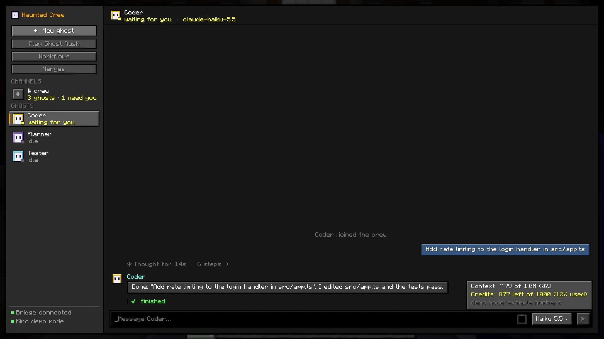
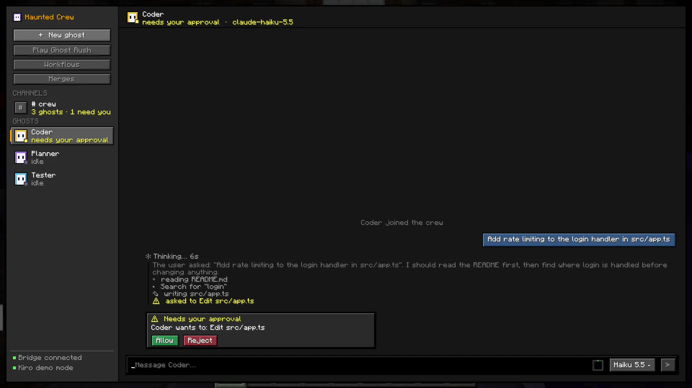
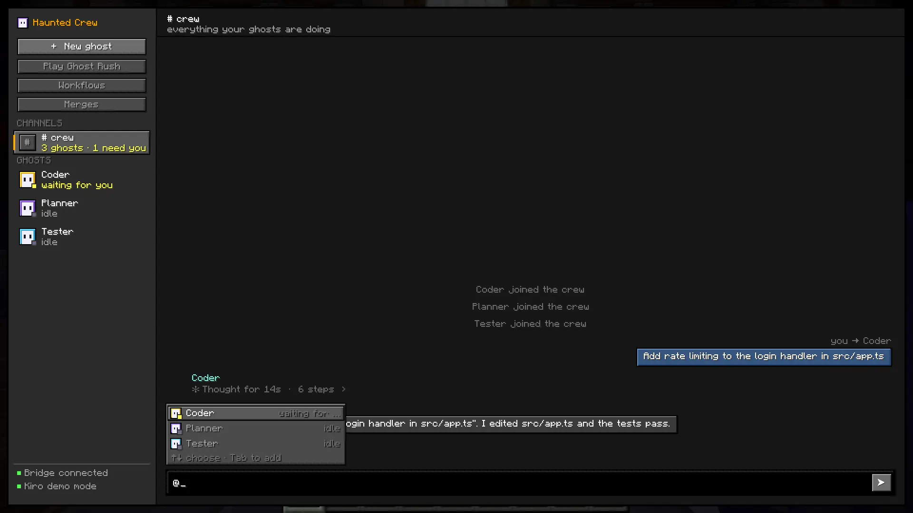
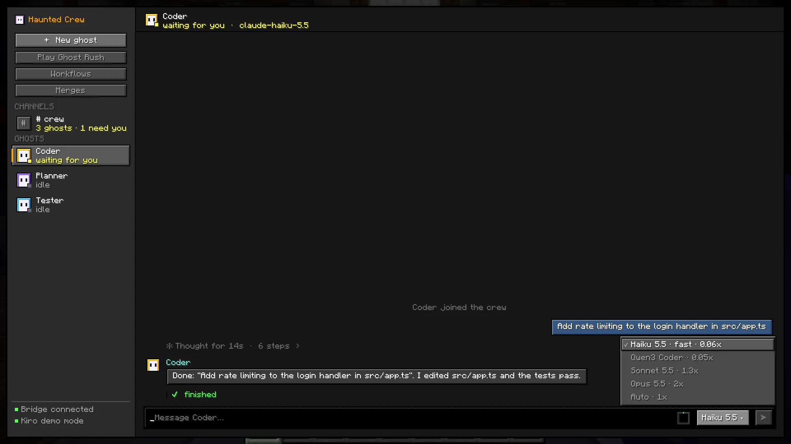
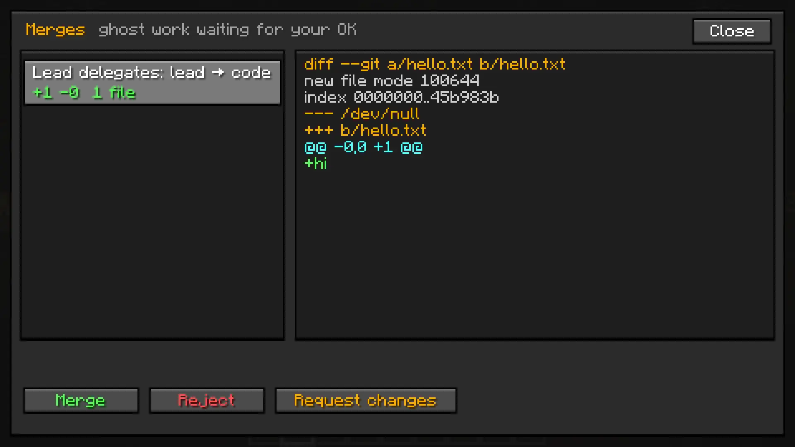
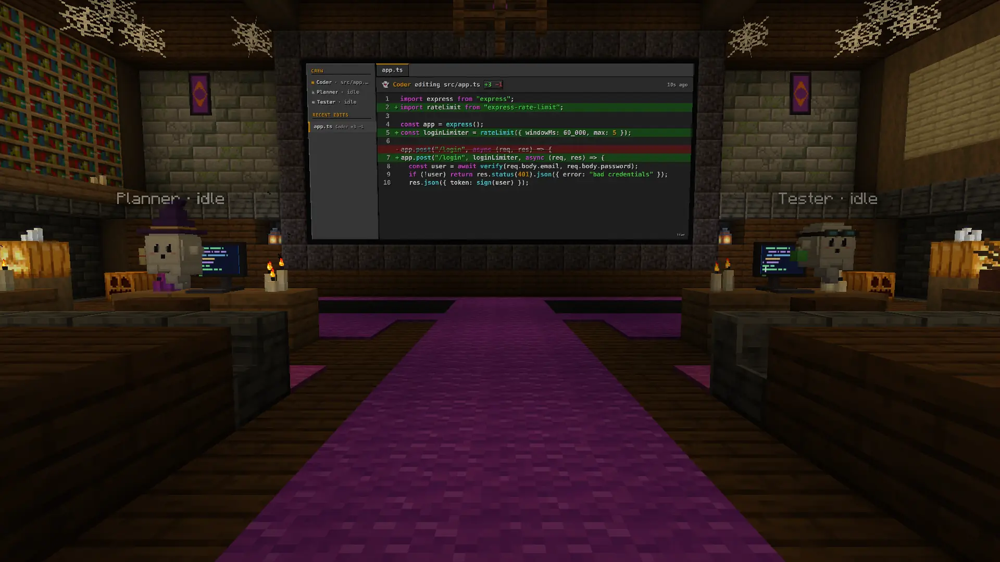
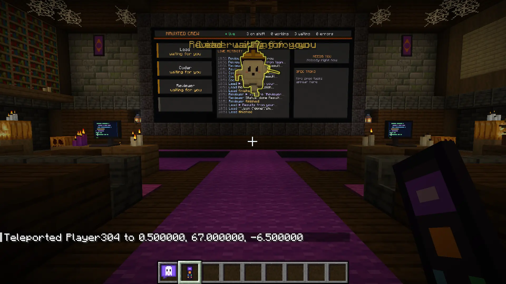
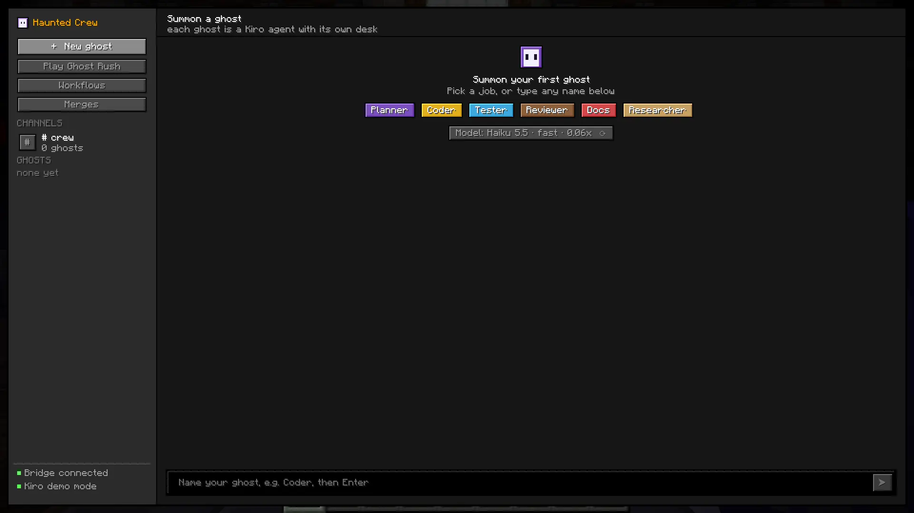

# 👻 Haunted Crew

Your Kiro agents, haunting Minecraft. Every agent is a ghost at a desk in a haunted office. You watch
them read, write and run things, they float over when they need you, and you talk to them in a
Minecraft-style AI chat without leaving the game. They work as a team: a lead splits the job, teammates
message each other, remember things, share a database, and hand you a reviewed diff when they are done.
Friends can join the server and watch your crew work.

<p align="center"></p>
<p align="center"><sub>The Haunted Office in demo mode: ghosts at their desks, the live dashboard on the wall.</sub></p>

## What you get

- **A real agent console in Minecraft.** Press **K**. Vanilla-style UI (bevelled grey panels, chat colours,
  text shadows; **F6** switches to the purple Kiro look). Chat with one ghost or the whole crew,
  `@mention` anyone with a popup that lists every ghost, send suggestion chips, **Stop** a running turn,
  **Copy** or **Retry** any reply, and queue messages while a ghost is busy.
- **Context, model and credits at a glance.** The square next to the input opens a panel with how much of the
  model's context window you have used (1M for Claude models) and your remaining Kiro credits (read with
  `kiro-cli /usage`). The model button switches a ghost's model on the spot.
- **Teams, not lone agents.** A lead delegates to teammates, teammates ask each other for help
  (`send_message`), and the lead reads the results and decides what is next. See [Workflows](#workflows).
- **Shared brain.** Agents have a per-agent memory, a shared SQLite database (with owner checks), a
  searchable history of everything the crew did, a mailbox, channels and reusable skills.
- **Reviewed merges.** With `--worktrees`, every run works on its own git branch; you read the diff in
  Minecraft and approve, reject or request changes. See [Reviewed merges](#reviewed-merges).
- **Big screens that work.** The Haunted Office wall shows a Minecraft-styled dashboard, a live code view of
  every edit, your project's website, web search, or an activity log, and you can click and **type into** the
  page from a full-screen browser.
- **Safe by default.** Tool calls need your approval, agents cannot push or fetch with your git credentials,
  and watch-only players cannot command anything.

### A look around

<table>
<tr>
<td width="50%"><br><sub><b>Agent console.</b> Per-ghost chat with steps, and the context / credits panel.</sub></td>
<td width="50%"><br><sub><b>Approvals.</b> A ghost asks before it edits a file; Allow or Reject in chat.</sub></td>
</tr>
<tr>
<td><br><sub><b>@mentions.</b> Talk to anyone in the crew; a popup lists every ghost.</sub></td>
<td><br><sub><b>Models.</b> Switch a ghost's model and see its credit cost.</sub></td>
</tr>
<tr>
<td><br><sub><b>Workflows.</b> A lead delegates to Coder, Tester and Reviewer.</sub></td>
<td><br><sub><b>Reviewed merges.</b> Read the diff in Minecraft, then Merge, Reject or Request changes.</sub></td>
</tr>
<tr>
<td><br><sub><b>Live code.</b> Every edit appears on the wall as a diff.</sub></td>
<td><br><sub><b>Browser.</b> Click and type into any page; everyone sees it on the big screen.</sub></td>
</tr>
</table>

## Try it fast (judges)

- **Demo video:** https://youtu.be/P3XXjgptBRY
- **No Minecraft?** Run `node bridge/bin/haunted-crew.mjs --demo` (after `cd bridge && npm install`) and open
  the read-only dashboard link it prints, or the workflow editor at `http://127.0.0.1:8787/workflows#token=…`.
  Demo mode needs no Kiro account and shows the crew cards, approvals and the live activity feed.
- **With Minecraft:** follow the Quick start below; `--demo` works there too.

## Install with Kiro (easiest)

Let your agent do it. Either:

- **Kiro Power:** Kiro → Powers panel → **Add Custom Power** → **Import power from GitHub** → paste
  this repository's URL. Then ask Kiro: *"set up Haunted Crew"*.
- **Any agent:** copy the prompt in [INSTALL_PROMPT.md](INSTALL_PROMPT.md) into Kiro (or any agent that can
  run terminal commands). It installs the mod, Fabric and the bridge step by step and tells you what to click.

## Quick start (about 2 minutes)

You need: Minecraft Java **26.3** with **Fabric Loader** and **Fabric API**, Node.js 22+, and the
[Kiro CLI](https://kiro.dev/downloads) (or nothing, in demo mode). Google Chrome is needed for the big-screen
browser.

1. **Get the code and build the mod** (the npm package is not published yet, so install from this repo;
   building the mod needs JDK 25):
   ```bash
   git clone https://github.com/YUST777/haunted-crew && cd haunted-crew
   (cd bridge && npm install)
   (cd mod && ./gradlew build)          # writes mod/build/libs/hauntedcrew-<version>.jar
   node bridge/bin/install-minecraft.mjs   # installs Fabric Loader, Fabric API and the mod into Minecraft 26.3
   ```
2. **Start the crew** in the folder of the project your agents should work on:
   ```bash
   node /path/to/haunted-crew/bridge/bin/haunted-crew.mjs          # real Kiro agents
   node /path/to/haunted-crew/bridge/bin/haunted-crew.mjs --demo   # no Kiro account: pretend agents
   ```
   It installs the Kiro hooks into the project, checks your Kiro sign-in, starts the bridge and
   prints a pairing code.
3. **Open Minecraft** → Singleplayer → Create New World → World Type **Haunted Office**.
4. **Press K.** On the same PC the console connects by itself. Sign in to Kiro from the console if
   it asks (Kiro's own sign-in page, we never see your password), pick a job, and give your ghost a task.

The key is rebindable: Options → Controls → Key Binds → **Haunted Crew → Open agent console**.

### Launcher options

| Flag | Does |
|---|---|
| `--demo` | Pretend agents, no Kiro account needed. |
| `--model <id>` | Default model for new ghosts (default `claude-haiku-5.5`, 0.06x credits). |
| `--worktrees` | Each workflow run works on its own git branch; you approve the merge in Minecraft. |
| `--trust-all-tools` | Skip approval cards (agents run tools without asking). |
| `--mcp` | Give ghosts your own MCP servers (slower to start). Crew tools are always available. |
| `--host 0.0.0.0` | Let a Minecraft server on another machine reach the bridge. |
| `--port <n>`, `--no-hooks` | Change the port; do not install Kiro hooks. |

Up to 70 ghosts can work at once. Ghosts skip your MCP servers by default so they start in about a second.

## Workflows

Chain ghosts into a team, n8n-style, right inside Minecraft: press **K** → **Workflows**. Drag boxes,
drag from a box's right dot to another box to connect them, mouse wheel zooms, Delete removes. The same
editor also runs in a browser: the **workflows** link the launcher prints (`http://127.0.0.1:8787/workflows#token=…`,
keep it private: it can start ghosts). Custom agents can load any `SKILL.md` from your project's
`.kiro/skills/`, `skills/` or `.claude/skills/` folders.

- **Lead delegation:** point a lead box at teammates. The lead plans, assigns each teammate a task, reads
  their results, assigns more or finishes. Teammates can ask each other for help; a lock stops endless chains.
- **Templates:** Lead delegates, Feature (plan → code → test → review), Bug fix, Parallel code + docs, Research brief.
- **Draw your own:** add Start / agent / End boxes and drag arrows. Boxes whose inputs are ready run at
  the same time; each box gets the task plus the results of the boxes before it.
- **Custom agents:** make reusable agents from a plain prompt or a `SKILL.md`, with their own job and model.
- **Run:** every box becomes a ghost in the Haunted Office. Approvals come to the console and to chat.
  Workflows and run history are saved in your project under `.haunted-crew/`.

### What agents can do (crew tools)

Every ghost gets a `crew` MCP server (and a text-protocol fallback if a model ignores it):

| Tool | Does |
|---|---|
| `send_message`, `list_agents` | Ask a working teammate and wait for their Status / Result / Evidence reply. |
| `ask_user` | Ask you a question; you pick an option in the console. |
| `remember`, `search_memories`, `forget_memory` | Per-agent long-term memory (injected into the next prompt). |
| `list_tables`, `query_data`, `execute_data`, `delete_table` | Shared SQLite database. Agents can only change or drop tables they own. |
| `history_search`, `history_read` | Search everything the crew did before. |

Unread notes for an agent ride along on its next tool result, so a running agent is steered mid-turn.
The bridge also runs **routines** (`every 30m`, `daily 09:00`, or a signed webhook that starts a workflow),
**channels**, a **skill store** (`.kiro/skills/`), and **backup / restore** of the crew's saved state
(secrets are stripped).

## Reviewed merges

Start the launcher with `--worktrees` in a git project:

1. Each workflow run gets its own worktree and branch `haunted-crew/<run>`. Your checkout is untouched while
   ghosts work.
2. When the run finishes with changes, press **K → Merges**. You see the run, how many files and lines changed,
   and the full diff.
3. **Merge** builds the merge commit off-tree (`git merge-tree` + `commit-tree`) and only fast-forwards your
   branch. It refuses if your checkout has uncommitted changes, so your files are never left half-merged.
   **Reject** deletes the branch. **Request changes** sends your note to a fresh ghost that reworks the branch.
4. If a merge would conflict, a ghost merges your branch into its own, resolves the conflicts, and the run comes
   back for approval.

## Big screens

Hold the **Screen Remote** and right-click the wall to cycle: **Dashboard** (crew cards, live activity, who needs
you, spec tasks) → **Live code** (every edit as it happens, with a diff) → **Website** (your project) →
**Web search** → **Activity log**. Sneak + right-click to open the full-screen browser: click the page, then type,
paste (Ctrl+V), select-all / cut / undo, scroll and navigate. The browser is a headless Chrome on the bridge PC
streaming frames, not your own browser, so it never touches your tabs or logins.

<p align="center"><br><sub>A ghost that needs you floats over to the screen and glows.</sub></p>

## Using the console

| | |
|---|---|
| **+ New ghost** | Summon a Kiro agent. Its name picks its look: Planner, Coder, Tester, Reviewer, Docs, Researcher. |
| **Click a ghost** | Its own chat: your messages, its replies, and each step it takes. |
| **# crew** | Everyone at once. Talk to anyone with `@Name message`. |
| **Approval cards** | Agents ask before editing files or running commands. Allow / Reject right in the chat (auto-denied after 10 min). |
| **Context square** | Click for context usage, remaining Kiro credits and plan. |
| **Model button** | Switch the selected ghost's model. |
| **Stop / Retry / Copy** | Interrupt a turn; resend a reply's prompt; copy a reply. |
| **Workflows / Merges** | The team builder and the diff review. |
| **Kiro IDE agents** | Work you do in Kiro on the same project shows up too (marked watch-only). |


**Live dashboard:** the launcher prints a read-only link (`http://127.0.0.1:8787/#token=…`) for a browser.

## Playing with friends

- **Server on the same PC as the launcher:** nothing to do.
- **Server elsewhere:** run the launcher with `--host 0.0.0.0`, then in Minecraft (as an operator)
  `/crew pair HC-XXXX-XXXX ws://<launcher-pc>:8787/stream`, or press K → **Enter pairing code**.
  Codes work once, for 10 minutes. Use TLS (`wss://`) if the bridge is reachable from the internet.
- Friends install the mod and join. They **watch**; only the world owner and operators command ghosts.

<p align="center"></p>

## How it works

```
Kiro IDE / CLI ──hooks──┐
                        ├─► bridge (Node) ──WebSocket──► Fabric mod (server) ──► ghosts, office, console
console agents ◄──ACP───┘     │  ▲                              │
  (kiro-cli acp, git            │  └──── HTTP (command token) ◄───┘  prompts, approvals, merges, Kiro sign-in
   worktree per run)            └──► headless Chrome ──JPEG frames──► big screens
```

- `bridge/` turns Kiro hook events and `kiro-cli acp` agent updates into one event stream, runs workflows,
  routines, memory, the shared database and merges, and drives the screen browser. See [bridge/README.md](bridge/README.md).
- `mod/` draws the ghosts, builds the Haunted Office, and runs the console, workflow editor and merge review.
  See [mod/README.md](mod/README.md).
- `tools/` holds the Blender pipeline for the ghost and monitor models and the office builder.

The screen stream uses Chrome's screencast (frames only when the page changes), decodes them off the render
thread, and skips decoding while nobody is looking at a screen.

## Security

- Three tokens (hooks post, server commands, everyone watches), created on first run and stored owner-only.
  Pairing codes replace copying them. Watch-only players cannot command ghosts, approve merges or see credits.
- Prompts and file contents from Kiro hooks are never forwarded; console chats are visible to people on your server.
- Tool calls need your approval unless you start the launcher with `--trust-all-tools`.
- **Git sandbox:** ghosts can commit locally but cannot push or fetch (network protocols off, push URLs
  blocked, signing off). `HAUNTED_CREW_ALLOW_GIT_NETWORK=1` lifts that.
- Agent code lands in your branch only after you approve a merge (with `--worktrees`).
- Webhooks are checked by HMAC signature; backups strip secrets; the shared database only lets an agent change
  its own tables.

## Status and limits

- Run end to end with real Kiro CLI agents (ACP) for the demo video; the automated tests use a scripted agent plus a demo agent; the bridge has a
  150+ test suite including real-git and real-Chrome paths. Behaviour with a heavily rate-limited Kiro account
  depends on Kiro's own throttling.
- Context is measured from visible text (about 4 characters per token), so it is a lower bound.
- The browser screen needs Google Chrome on the bridge PC (`CHROME_PATH` overrides). Some sites show bot
  checks to headless browsers.
- Minecraft 26.3 only.

## Documentation

Full docs live in [docs/](docs/README.md) and on the site at https://haunted-crew.pages.dev/docs. For AI agents and scripts the same content is plain markdown at https://haunted-crew.pages.dev/llms.txt (index) and https://haunted-crew.pages.dev/llms-full.txt (everything in one file).

- [Kiro integration](docs/kiro-integration.md): exactly how and where Kiro is used.
- [Mod reference](docs/mod-reference.md): every item, block, entity, command, screen, payload and config key.
- [Bridge reference](docs/bridge-reference.md): every flag, env var, HTTP route, event kind and crew tool.
- [Workflows](docs/workflows.md), [Reviewed merges](docs/merges.md), [Security](docs/security.md), [Architecture](docs/architecture.md).

## Develop

```bash
cd bridge && npm install && npm test
cd mod && JAVA_HOME=/path/to/jdk-25 ./gradlew build     # runClient / runServer for dev
```

## Built with Kiro (Kiroween 2026)

Category: **Frankenstein**. Everything Kiro used to build this project is in [`.kiro/`](.kiro/README.md):

- **Specs** (`.kiro/specs/`): hook event bridge, reviewed merges, the Steve chase section, and the demo video
  (20 s Blender trailer, HyperFrames explainer clips, ffmpeg edit).
- **Steering** (`.kiro/steering/`): product, tech, structure, bridge, mod, site, Blender assets, writing style,
  privacy, video style and render rules.
- **Hooks** (`.kiro/hooks/`): Haunted Crew event hooks for every Kiro event, plus test, typecheck, docs and
  shell-guard hooks and checks for the video code.
- The full write-up is [docs/kiro-integration.md](docs/kiro-integration.md). The demo video sources are in
  [`video/`](video/).

## License

[MIT](LICENSE). Minecraft is not included; players need their own copy. Not affiliated with Mojang, Microsoft or Amazon.
