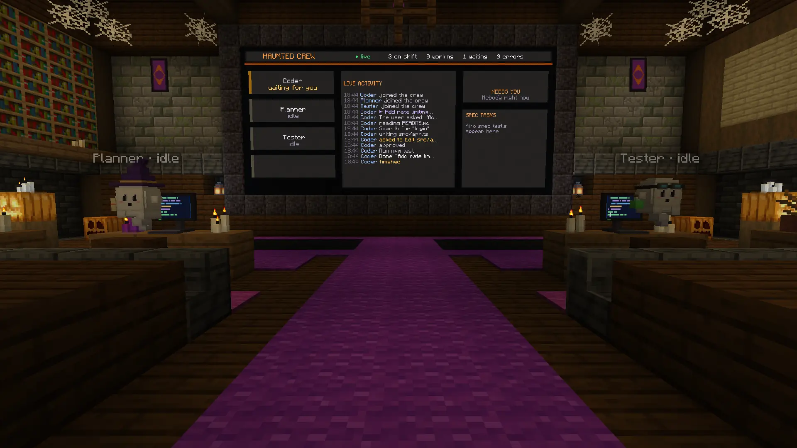

# Haunted Crew documentation

Haunted Crew turns Kiro agents into ghosts in Minecraft. A small Node **bridge** talks to Kiro, a Fabric **mod**
draws the ghosts and the console, and everything the agents do shows up in the world.

## Built with Kiro (Kiroween 2026, Frankenstein)

The product runs on Kiro: every ghost is a real `kiro-cli` agent, tested end to end with real Kiro. The Kiro setup
for this repo is in the [`.kiro/` folder](https://github.com/YUST777/haunted-crew/tree/main/.kiro):

| Kiro feature | How it is used here |
|---|---|
| Specs (6) | Requirements, design and task lists for the hook event bridge, reviewed merges and the demo video (trailer, explainer clips, edit). |
| Hooks (18) | Ten forward every Kiro event to the ghosts in Minecraft. The others run the bridge tests on save, typecheck the site, keep the docs true to the code and block risky shell commands. |
| Steering (11) | Product, tech, structure, mod, bridge, site, Blender assets, privacy, writing style and video rules, loaded into every Kiro session. |
| Agents (ACP) | Every ghost is a real `kiro-cli` agent over the Agent Client Protocol, with its own generated agent profile. |
| MCP | A crew MCP server gives ghosts messages, memory, a shared database and history; Blender was driven through MCP for the models. |
| Powers | `plugin.json` and the `haunted-crew-setup` skill let Kiro install the whole project from one prompt. |

The full write-up is [Kiro integration](kiro-integration.md).

## Pages

| Page | What it covers |
|---|---|
| [Kiro integration](kiro-integration.md) | Exactly how and where Kiro is used: ACP, hooks, agent profile, MCP, skills, credits, plugin. |
| [Mod reference](mod-reference.md) | Every item, block, entity, command, key, screen, payload and config key in the Minecraft mod. |
| [Bridge reference](bridge-reference.md) | Every flag, env var, HTTP route, event kind, crew tool and module in the bridge. |
| [Architecture](architecture.md) | The three parts, the data flow, and why it is built this way. |
| [Bridge](bridge.md) | Every bridge module: ACP, agents, workflows, memory, database, routines, browser, backup. |
| [Workflows](workflows.md) | Lead delegation, templates, custom agents, the crew tools, mid-turn steering. |
| [Reviewed merges](merges.md) | Git worktrees per run, off-tree merge, the in-game diff review, conflict and rework ghosts. |
| [Screens and browser](screens.md) | The wall dashboard, live code, and the headless-Chrome browser pipeline. |
| [Minecraft mod](mod.md) | Ghost entities, the office, console, workflow editor, merge screen, rendering. |
| [Security](security.md) | Tokens, pairing, the git sandbox, approvals, privacy. |
| [Testing](testing.md) | The test suite and how to check the whole system. |

Quick start lives in the [main README](../README.md). The HTTP API table is in [bridge/README.md](../bridge/README.md).

