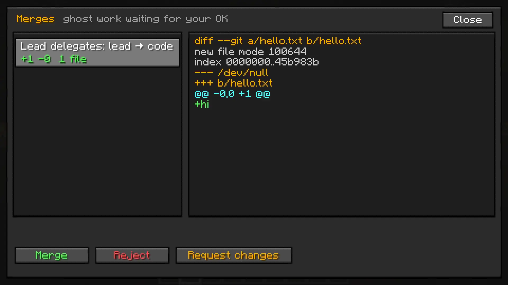

# Reviewed merges

Start the launcher with `--worktrees` inside a git repository.

## Lifecycle

1. **Run.** `worktrees.create` makes `.haunted-crew/worktrees/<run>` on branch `haunted-crew/<run>`. Every ghost in the
   run works there; your checkout is untouched.
2. **Finish.** When the run ends with changes, they are committed to the branch and the run becomes *pending*.
3. **Review.** **K → Merges** lists pending runs with files and line counts; selecting one shows the coloured diff.
4. **Decide.**
   - **Merge** builds the merge commit off-tree with `git merge-tree --write-tree` and `git commit-tree`, then
     `merge --ff-only` moves your branch. It refuses when your checkout is dirty, so nothing is half-merged.
   - **Reject** removes the worktree and branch.
   - **Request changes** sends your note to a fresh *Reviser* ghost that reworks the branch; the run returns for approval.
5. **Conflicts.** If the merge would conflict, a *Resolver* ghost merges your branch into the run branch, resolves the
   conflicts and the run comes back with the note "Resolver finished: review again".

## Errors

`MergeError` codes: `dirty`, `conflict`, `empty`, `refused`, `failed`. The HTTP answer carries the reason.

## Agent git sandbox

Ghosts may commit locally. Network protocols are disabled (`protocol.allow=never`), push URLs are blocked, signing is
off and terminal prompts are disabled, all through `GIT_CONFIG_*` environment variables set per agent process.
`HAUNTED_CREW_ALLOW_GIT_NETWORK=1` lifts this.
