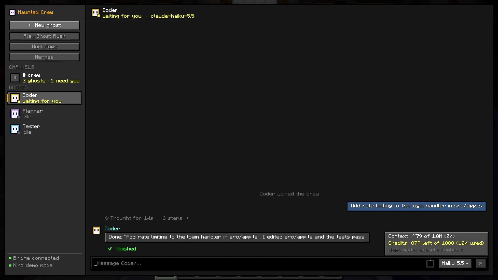

# Minecraft mod

Fabric, Minecraft 26.3, Java 25. Source sets: `src/main` (server and shared) and `src/client`.

## Server side (`dev.hauntedcrew`)

| Class | Role |
|---|---|
| `HauntedCrew` | Entry point, commands (`/crew pair …`), registration. |
| `BridgeClient` | WebSocket stream and HTTP calls to the bridge. |
| `CrewManager` | Maps bridge sessions to ghost entities and desks. |
| `GhostEntity` | The ghost: status glow, held item by tool category, walks to its desk. |
| `Office`, `ScreenWall`, `ScreenEntity`, `MonitorBlock` | The Haunted Office build and the big screens. |
| `ConsoleService`, `ConsolePayloads`, `CrewProtocol` | Console actions between client and server, including `workflow_*` and `merge_*`. |
| `CrewItem`, `Guide`, `CrewConfig` | Items (Screen Remote), the in-game guide, config. |

## Client side (`dev.hauntedcrew.client`)

| Class | Role |
|---|---|
| `ConsoleScreen` | Chat with ghosts, `# crew`, approval cards, model button, context square. |
| `WorkflowScreen` | Drag-and-drop workflow editor. |
| `MergeScreen` | Pending merges, coloured diff, Merge / Reject / Request changes. |
| `BrowserScreen` | Full-screen browser with typing, paste and scrolling. |
| `GhostRenderer`, `GhostModel`, `GhostRenderState` | Ghost rendering. |
| `ScreenRenderer`, `ScreenTexture` | Wall screens and async JPEG decoding. |
| `ClientConsole` | Client state fed by bridge snapshots. |

All screens share one Minecraft-style look: dark panel, grey bars, black outlines, stone-style buttons.

<p align="center"></p>

## Build

```bash
cd mod && ./gradlew build        # needs JDK 25
./gradlew runClient               # dev client
```
