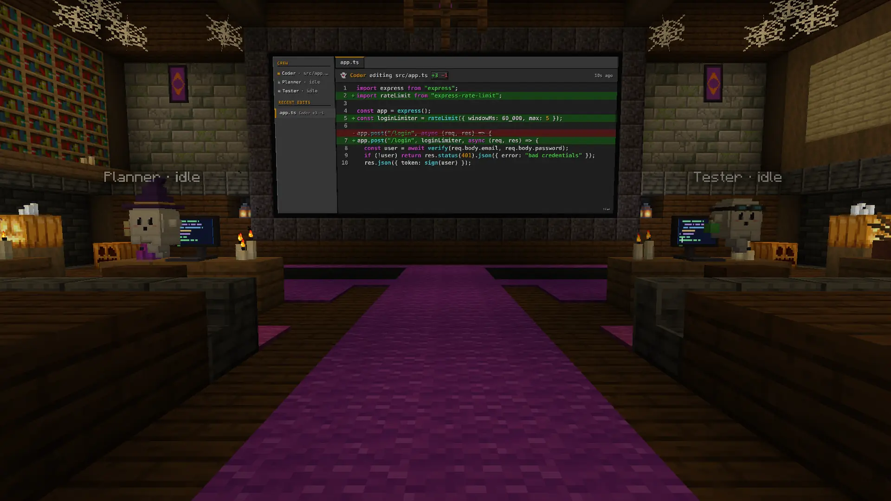
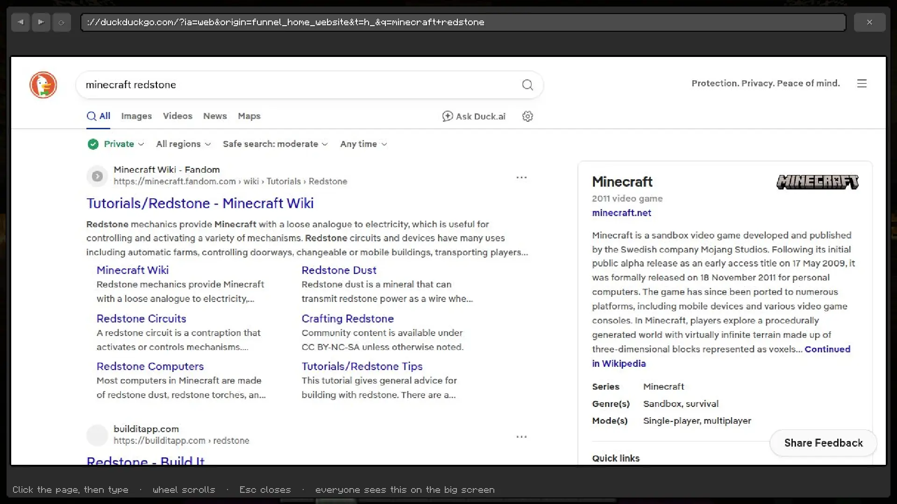

# Screens and browser

Hold the **Screen Remote** and right-click a wall to cycle its mode.

| Mode | Shows |
|---|---|
| Dashboard | Crew cards, live activity, who needs you, spec tasks. |
| Live code | Every edit as it happens, with a coloured diff. |
| Website | Your project's dev server. |
| Web search | A search page. |
| Activity log | Recent events. |

Sneak + right-click opens the full-screen browser.

## The browser pipeline

- A **headless Chrome** runs on the bridge PC (`puppeteer-core`, `CHROME_PATH` overrides). It has its own profile, so it
  never touches your tabs or logins.
- `Page.startScreencast` sends JPEG frames only when the page changes, at a single CSS-pixel size. A screenshot
  fallback is used only when the cast has gone quiet for 1.5 s.
- The mod's `ScreenTexture` decodes frames on a worker thread, keeps only the latest, and uploads on the render
  thread. `touch()` / `seen()` culling skips decoding for screens nobody is looking at.
- Input goes back over `POST /browser/{click,type,key,scroll,…}`. Keys include `Control+a`, `Shift+Tab`, arrows;
  Ctrl+V pastes up to 200 characters. Minecraft 26.3's SDL text input is switched on after each click.
- The user agent drops the "Headless" marker and the automation flags are off, which avoids most bot checks.
- Zoom is remembered per host in the profile.

## Theming

The wall is drawn in flat Minecraft materials: black frame, grey face, an orange accent on the header, and the same
palette as the console screens (`0xF0101010` background, `0xFF4A4A4A` bars).
